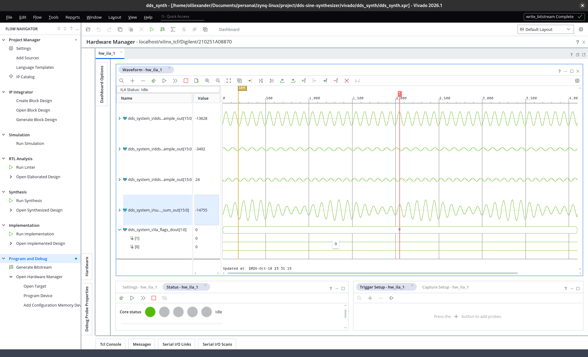

# dds-sine-synthesizer

8-channel additive DDS sine synthesizer on Zynq-7000 (VHDL), controlled from a serial terminal via a MicroBlaze CLI.

**Coursework report (Ukrainian): [REPORT.md](REPORT.md)**



## Overview

Eight independent direct digital synthesis channels generate sine waves with their own frequency, phase and
amplitude. Their sum is the output signal, so any waveform that is a sum of up to eight sines can be produced:
AM, beats, square or triangle waves from harmonics, pulse trains. A single command line describes the whole signal.

```
dds> 1000:0.8 900:0.2 1100:0.2
  ch0  1000.000 kHz  0.800 V  0.000 deg
  ch1  900.000 kHz  0.200 V  0.000 deg
  ch2  1100.000 kHz  0.200 V  0.000 deg
```

- Board: Smart ZYNQ SL (XC7Z020-CLG484), 100 MHz fabric clock.
- Tools: Vivado / Vitis 2026.1, VHDL-2008, C (bare-metal MicroBlaze).

## Architecture

```
C firmware → MicroBlaze → AXI4-Lite → dds_channel ×8 → summer → sd_dac → dac_out (H19) → RC filter
                 │                         ▲                        └→ ovf_led (P20)
                 ├→ AXI GPIO (1 bit) ──────┘ sync: load all phases in the same clock
                 └→ AXI UARTLite 230400 ↔ CH340N ↔ USB ↔ terminal
```

| Block | Description |
|---|---|
| `dds_channel` (IP) | 32-bit phase accumulator, 1024 × 16 sine ROM, amplitude multiplier (DSP48), 5 AXI4-Lite registers |
| `summer` | exact 19-bit sum of 8 channels, saturation to 16 bits, overflow flag, 3-stage pipeline |
| `sd_dac` | 1-bit first-order sigma-delta modulator for an RC reconstruction filter |
| firmware | channel self-test, line-based CLI, kHz/V/deg to register conversion, amplitude limits |

### `dds_channel` register map

| Offset | Name | Access | Description |
|---|---|---|---|
| 0x00 | `FTW` | R/W | frequency tuning word, `f = FTW · 100 MHz / 2³²` |
| 0x04 | `PHASE` | R/W | start phase, `2³²` = 360°, loaded on `load` or `sync` |
| 0x08 | `AMP` | R/W | amplitude 0…0x8000 (0x8000 = full scale), larger values clamp |
| 0x0C | `CTRL` | R/W | [0] enable, [1] step (one sample), [2] load phase; bits 1–2 self-clear |
| 0x10 | `SAMPLE` | R | last output sample, signed 16 bit |

`sample = floor(round(32767 · sin(phase)) · AMP / 32768)`, taken from the phase before `FTW` is added.
Channel `i` is at `0x44A0_0000 + i · 0x1_0000`.

## Command line

```
<freq_kHz>:<amp_V>[:<phase_deg>] ...   up to 8 tones, one per channel
off                                     all channels off
help                                    usage
```

- Decimal separator `.` or `,` (`1,5` = 1.5 kHz).
- Limits: ≤ 1.000 V per channel, ≤ 1.650 V sum (DAC full scale), frequency < 50 MHz.
- A line that breaks a limit is rejected with a message and the previous signal keeps running.
- Unlisted channels are switched off; all listed channels start in phase on one `sync` pulse.

Examples:

| Signal | Line |
|---|---|
| AM, 1 MHz carrier, 100 kHz, m = 0.5 | `1000:0.8 900:0.2 1100:0.2` |
| beats | `1000:0.8 1050:0.8` |
| square wave, 8 odd harmonics | `100:0.8 300:0.267 500:0.16 700:0.114 900:0.089 1100:0.073 1300:0.062 1500:0.053` |
| triangle | `100:1 300:0.111:180 500:0.04 700:0.0204:180` |
| cancellation in antiphase | `1000:0.5 1000:0.5:180` |

## Results

| Check | Result |
|---|---|
| channel testbench (`sim/tb_dds_channel.vhd`, 3 scenarios, hand-computed values) | PASS |
| same testbench on the broken copy (`sim/broken/`) | FAIL, 23 errors |
| system simulation with MicroBlaze and the real firmware (`sim/tb_system.vhd`) | PASS |
| one channel after implementation | 196 LUT, 193 FF, 1 DSP, 0.5 BRAM36 |
| timing at 100 MHz | WNS +1.501 ns, WHS +0.033 ns, no violations |
| hardware | CLI over UART, waveforms captured with ILA and on an oscilloscope via the sigma-delta output and a two-stage RC filter |

Expected values of the testbench scenarios and the way they were obtained are in [REPORT.md](REPORT.md), section 3.

## Repository layout

```
rtl/dds_channel/   channel IP: VHDL sources, component.xml, xgui (packaged in place)
rtl/summer/        summer
rtl/dac/           sigma-delta DAC
sim/               channel and system testbenches, broken copy
sw/                firmware sources and the Vitis workspace script
constraints/       board XDC
vivado/            project, block design and build scripts
docs/              screenshots used in the report
```

## Building

```bash
source ~/Xilinx/2026.1/Vivado/settings64.sh
source ~/Xilinx/2026.1/Vitis/settings64.sh

vivado -mode batch -source vivado/create_project.tcl    # project + block design
vivado -mode batch -source vivado/export_xsa.tcl        # hardware platform
vitis  -s sw/create_workspace.py                         # platform + firmware ELF
vivado -mode batch -source vivado/create_project.tcl    # again, to associate the ELF
vivado -mode batch -source vivado/build_bitstream.tcl   # synthesis, implementation, bitstream
vivado -mode batch -source vivado/run_system_sim.tcl    # optional: system simulation (~20 min)
```

After every firmware rebuild run `source vivado/associate_elf.tcl` in the project before building the bitstream
(`build_bitstream.tcl` does it automatically).

Program the board from Hardware Manager (`dds_system_wrapper.bit` + `.ltx`) and open a terminal:

```bash
picocom -b 230400 /dev/ttyUSB0
```

The analog output is pin 3 of header J5 (H19). The oscilloscope captures in `docs/` use a two-stage RC low-pass:
1 kΩ + 1 nF followed by 10 kΩ + 100 pF (each stage 159 kHz, overall ≈ 102 kHz at −3 dB, ≤ 1 dB loss up to ~50 kHz).

## License

[Apache License 2.0](LICENSE)
