# Пояснювальна записка — курсовий проєкт

**Тема:** восьмиканальний адитивний DDS-синтезатор синусоїд у системі з MicroBlaze.
**Інструменти:** Vivado / Vitis 2026.1; VHDL-2008 (мова узгоджена з викладачем), C (bare-metal MicroBlaze), XSim.
**Плата:** Smart ZYNQ SL (XC7Z020-CLG484). Усі обов'язкові кроки виконано в симуляції, додатково — запуск на платі з ILA.

---

## 1. Що робить система

Модуль `dds_channel` — один канал прямого цифрового синтезу (DDS): 32-бітний фазовий акумулятор щотакту додає
частотне слово `FTW`, старші 10 розрядів фази адресують таблицю синуса, значення множиться на амплітуду `AMP`.
На виході щотакту 16-бітний знаковий відлік синусоїди з частотою `f = FTW · f_clk / 2³²` (f_clk = 100 МГц).

Система складає вісім таких синусоїд в один сигнал (адитивний синтез):

```
програма на C → MicroBlaze → AXI4-Lite → dds_channel ×8 → summer → sd_dac → dac_out (H19)
                    │                         ▲                        └→ ovf_led (P20)
                    ├→ AXI GPIO (1 біт) ──────┘ sync: одночасне завантаження фаз усіх каналів
                    └→ AXI UARTLite (230400) ↔ CH340N ↔ USB ↔ термінал (CLI)
```

- `dds_channel` — IP з п'ятьма регістрами AXI4-Lite (оцінюваний модуль);
- `summer` — точна сума 8 × 16 біт у 19 бітах, насичення до 16 біт, прапорець `ovf`, конвеєр 3 такти;
- `sd_dac` — 1-бітний сигма-дельта модулятор 1-го порядку для RC-фільтра й осцилографа;
- прошивка — самотест каналів і командний рядок: один рядок задає весь сигнал (до 8 тонів).

---

## 2. Крок 1. IP з регістрами AXI4-Lite

Шаблон AXI4-Lite slave згенеровано майстром Vivado *Create and Package New IP → AXI4 peripheral* (VHDL, 5 регістрів),
далі почищено й розділено на файли за відповідальністю:

| Файл | Що робить |
|---|---|
| `rtl/dds_channel/dds_channel.vhd` | верхній рівень IP, з'єднання |
| `rtl/dds_channel/dds_channel_regs.vhd` | AXI4-Lite handshake і регістри (шаблон майстра) |
| `rtl/dds_channel/dds_core.vhd` | акумулятор фази, `enable/step/load`, множник амплітуди |
| `rtl/dds_channel/sine_lut.vhd` | таблиця синуса 1024 × 16, обчислюється при елаборації |

### Таблиця регістрів

| Зсув | Назва | Програма | Значення |
|---|---|---|---|
| 0x00 | `FTW` | пише / читає | частотне слово, `f = FTW · 100 МГц / 2³²` |
| 0x04 | `PHASE` | пише / читає | початкова фаза, `2³²` = 360°; завантажується в акумулятор по `load` або `sync` |
| 0x08 | `AMP` | пише / читає | амплітуда [15:0], 0…0x8000 (0x8000 = повна шкала); більші значення обмежуються до 0x8000 |
| 0x0C | `CTRL` | пише / читає | [0] `enable` — рахувати щотакту; [1] `step` — один крок при `enable` = 0; [2] `load` — завантажити `PHASE`. Біти 1 і 2 самоскидні |
| 0x10 | `SAMPLE` | читає | останній відлік [15:0], знакове число |

Порти, крім AXI: `sync` (вхід, діє як `load`) і `sample_out[15:0]` (вихід щотакту).

**Закон обчислення.** `lut(i) = round(32767 · sin(2π·i/1024))`, адреса — `acc[31:22]`;
`sample = floor(lut · AMP / 32768)` (арифметичний зсув, від'ємні значення округлюються вниз).
Відлік береться з фази **до** додавання `FTW`, тому перший відлік після `load` дорівнює `sin(PHASE)`.

---

## 3. Крок 2. Тестбенч модуля

`sim/tb_dds_channel.vhd` звертається до каналу через AXI4-Lite так само, як MicroBlaze, і сам порівнює результат з
числами, порахованими вручну до запуску. Сценарії покрокові: `load`, читання `SAMPLE`, далі кожен `step` і читання.

### Очікувані значення і як їх отримано

Опорні значення таблиці (рахуються за формулою вище): `sin 0° = sin 180° → 0`, `sin 45° → 23169.77 → 23170`,
`sin 90° → 32767`.

**Сценарій 1 — чверть періоду за крок.** `FTW = 0x4000_0000` (90°), `PHASE = 0`, `AMP = 0x8000` (множник 1).
Фази 0°, 90°, 180°, 270°, … → відліки таблиці без змін:

```
0, 32767, 0, -32767, 0, 32767, 0, -32767
```

**Сценарій 2 — косинус на половині амплітуди.** `FTW = 0x2000_0000` (45°), `PHASE = 0x4000_0000` (90°), `AMP = 0x4000` (0,5).
Фази 90°, 135°, …, 45° → таблиця 32767, 23170, 0, −23170, −32767, −23170, 0, 23170 → `floor(x · 0,5)`:

```
16383, 11585, 0, -11585, -16384, -11585, 0, 11585
```

`32767 · 0,5 = 16383,5 → 16383`, а `−32767 · 0,5 = −16383,5 → −16384`: асиметрія округлення вниз перевіряється навмисно.

**Сценарій 3 — граничні випадки** (параметри сценарію 1):

| Перевірка | Очікування |
|---|---|
| 4 кроки | `0, 32767, 0, -32767` |
| без `enable` і `step` 20 тактів | `sample_out` і `SAMPLE` тримають `-32767` |
| запис `CTRL = 0b110`, читання `CTRL[2:0]` | `0` (самоскидання) |
| `AMP = 0`, `enable` = 1, 16 тактів | усі `0` |
| `AMP = 0xFFFF`, фаза 90° | `32767` (обмеження до 0x8000, без переповнення) |
| імпульс `sync`, `PHASE = 270°` | `-32767` (діє як `load`) |

Плюс перевірка запису/читання регістра: `FTW = 0x12345678` → читання `0x5678` у молодших 16 бітах (22136).

### Результат: PASS

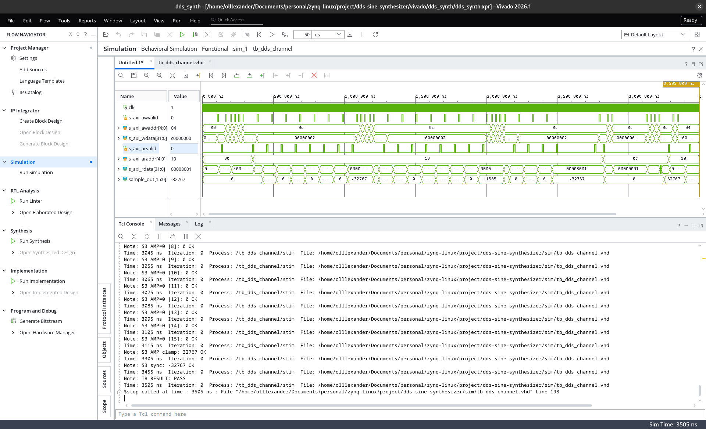

```
readback FTW: 22136 OK
S1[0]: 0 OK
S1[1]: 32767 OK
S1[2]: 0 OK
S1[3]: -32767 OK
S1[4]: 0 OK
S1[5]: 32767 OK
S1[6]: 0 OK
S1[7]: -32767 OK
S2[0]: 16383 OK
S2[1]: 11585 OK
S2[2]: 0 OK
S2[3]: -11585 OK
S2[4]: -16384 OK
S2[5]: -11585 OK
S2[6]: 0 OK
S2[7]: 11585 OK
S3 steps[0]: 0 OK
S3 steps[1]: 32767 OK
S3 steps[2]: 0 OK
S3 steps[3]: -32767 OK
S3 hold sample_out: -32767 OK
S3 hold SAMPLE: -32767 OK
S3 CTRL self-clear: 0 OK
S3 AMP=0 [0]: 0 OK
  … (16 відліків, усі 0 OK)
S3 AMP=0 [15]: 0 OK
S3 AMP clamp: 32767 OK
S3 sync: -32767 OK
TB RESULT: PASS
```

---

## 4. Крок 3. Зламана копія

`sim/broken/dds_core_broken.vhd` — копія `dds_core.vhd`, у якій таблиця адресується фазою `acc + FTW`, тобто на
крок уперед. Для перевірки є окремий набір симуляції `sim_broken`: той самий тестбенч, але з цією копією замість
`dds_core.vhd`. Тестбенч падає вже на першому відліку.

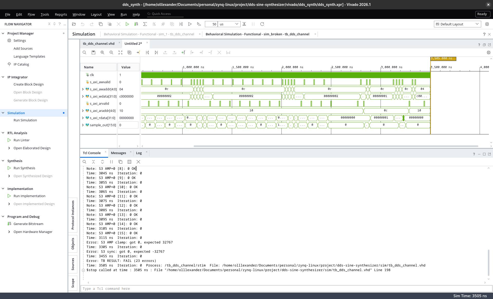

```
readback FTW: 22136 OK
S1[0]: got 32767, expected 0
S1[1]: got 0, expected 32767
S1[2]: got -32767, expected 0
S1[3]: got 0, expected -32767
  …
S2[0]: got 11585, expected 16383
  …
S3 hold SAMPLE: got 0, expected -32767
S3 AMP clamp: got 0, expected 32767
S3 sync: got 0, expected -32767
TB RESULT: FAIL (23 errors)
```

Регістровий доступ і `AMP = 0` проходять (вони від фази не залежать), а все, що залежить від фази, — ні.
Отже, тест справді перевіряє вихід, а не лише рукостискання AXI.

---

## 5. Крок 4. Package IP і IP Catalog

IP упаковано на місці (*Tools → Create and Package New IP → Package a specified directory → `rtl/dds_channel`*):
`component.xml` і `xgui/` лежать поруч з кодом, `rtl/dds_channel` підключено як IP-репозиторій проєкту.
Пакувальник сам розпізнав інтерфейс `s_axi` (aximm slave), такт і скидання; параметр `LUT_ADDR_BITS` винесено
в налаштування IP.

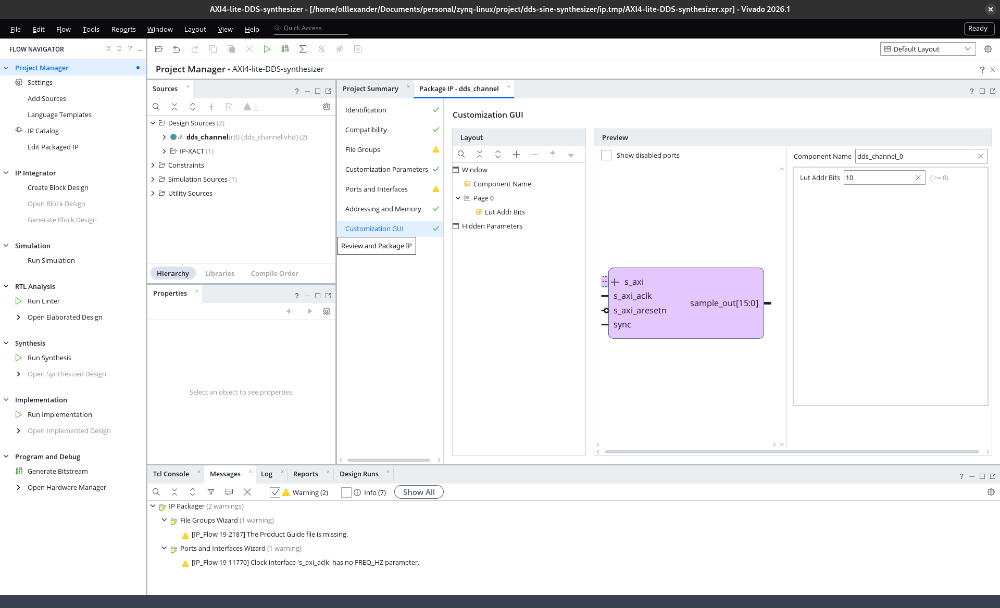
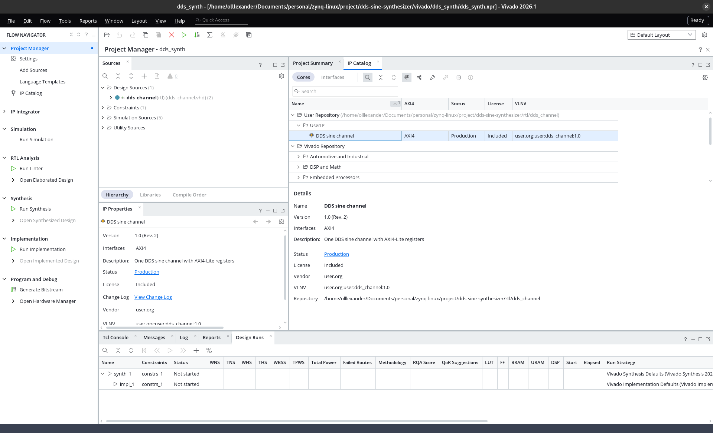

---

## 6. Крок 5. Block Design, валідація, адреси

Block Design `dds_system` зібрано скриптом `vivado/create_bd.tcl`: MicroBlaze (64 КБ локальної пам'яті, апаратний
множник), `clk_wiz` 50 → 100 МГц, `proc_sys_reset`, 8 × `dds_channel`, `summer` і `sd_dac` як Module Reference,
AXI GPIO для `sync`, AXI UARTLite, ILA для налагодження на платі. Зовнішні порти: `clk`, `rst_n`, `dac_out`, `ovf_led`,
`uart_txd/rxd`.

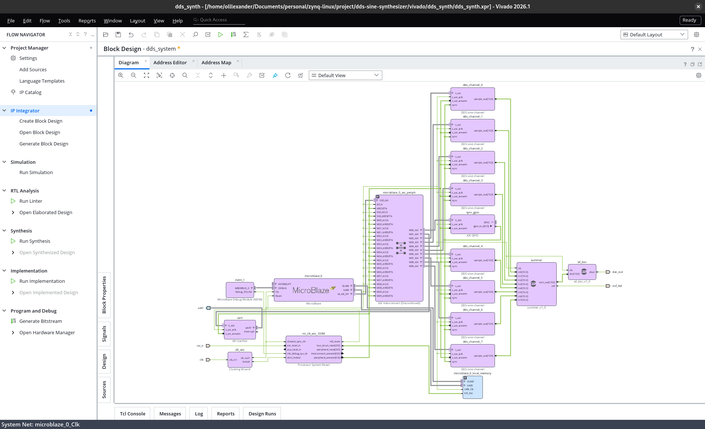

Повна схема у векторі: [docs/05_block_design.pdf](docs/05_block_design.pdf).

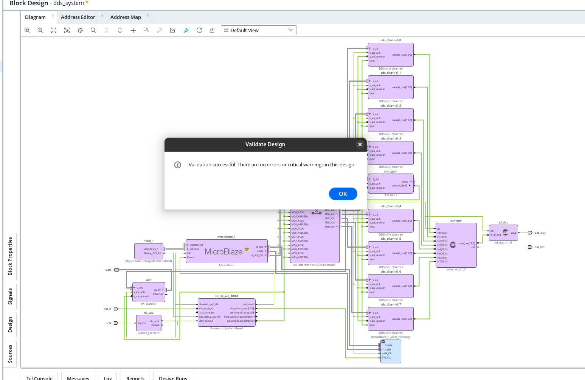

| Блок | Базова адреса | Діапазон |
|---|---|---|
| локальна пам'ять MicroBlaze | 0x0000_0000 | 64 КБ |
| `dds_channel_0` … `_7` | 0x44A0_0000 + i · 0x1_0000 | 64 КБ кожен |
| `sync_gpio` | 0x4000_0000 | 64 КБ |
| `uart` | 0x4060_0000 | 64 КБ |

Адреси каналів задано явно з однаковим кроком, тож у C адреса каналу — `0x44A00000 + ch * 0x10000`.

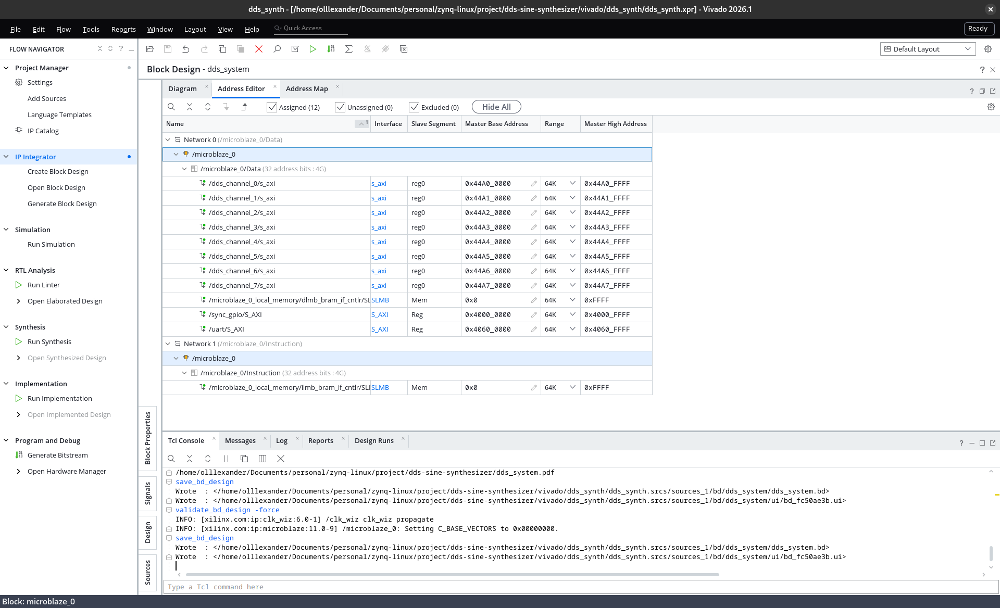

---

## 7. Крок 6. Системна симуляція

Behavioral-симуляція всієї системи з MicroBlaze і справжньою прошивкою (`sw/`). Тестбенч `sim/tb_system.vhd`
подає такт і скидання, а також грає роль термінала: надсилає рядки CLI в `uart_rxd`, розбирає відповіді з `uart_txd`
і через external names перевіряє регістри всіх восьми каналів та відлік каналу 0.

### Запис і читання регістрів (самотест прошивки)

При старті прошивка проганяє сценарії 1 і 2 на каналах 0 і 1 через AXI. На кадрі один крок сценарію 1:

| Маркер | Транзакція |
|---|---|
| 45 779 нс | **запис** `CTRL = step` (`awaddr = 0x0C`) |
| 46 480 нс | читання `CTRL` (`araddr = 0x0C`), біти step/load уже скинуті |
| 47 000 нс | **читання** `SAMPLE` (`araddr = 0x10`), відлік змінився з 32767 на 0 — як у сценарії 1 |

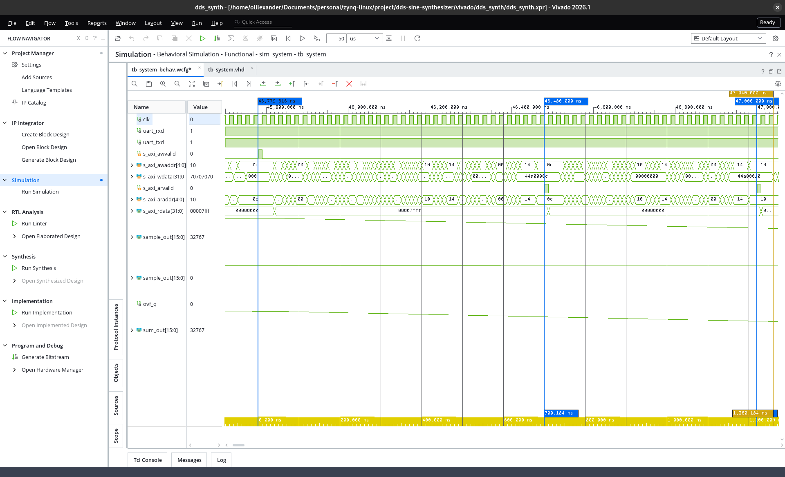

### Сценарії через командний рядок

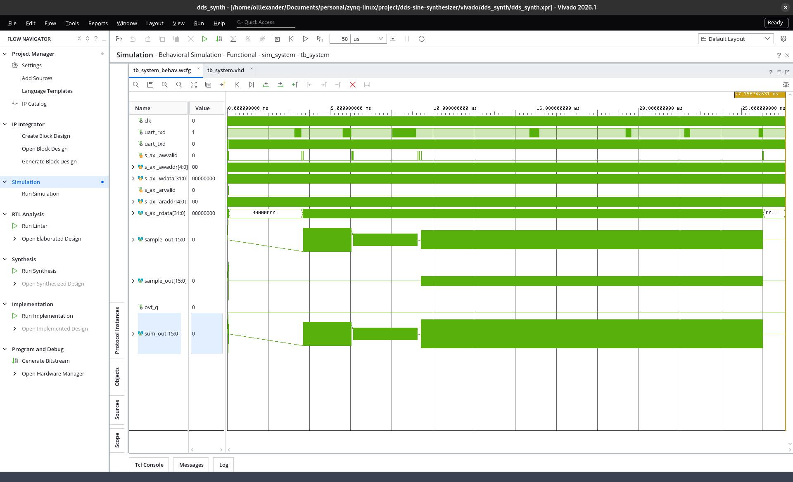

| Сценарій | Рядок | Що перевіряється |
|---|---|---|
| запуск | — | `self-test: PASS` |
| синусоїда 1 МГц, 1 В | `1000:1` | регістри каналу 0, пік `sample_out` = 19858 |
| та сама, 0,5 В (кома) | `1000:0,5` | код амплітуди 0x26CA, пік 9929 |
| AM: несуча 1 МГц, модуляція 100 кГц, m = 0,5 | `1000:0.8 900:0.2 1100:0.2` | FTW/AMP трьох каналів, пік 15887, `ovf = 0` |
| сума 1,7 В | `1:1 2:0.7` | відмова, стан каналів не змінився |
| 1,2 В на канал | `1:1.2` | відмова |
| некоректний рядок | `1:abc` | відмова |
| вимкнення | `off` | усі канали вимкнені й обнулені |

Очікувані коди: `FTW = round(f · 2³² / 100 МГц)` (1 МГц → 0x028F5C29, 0,9 МГц → 0x024DD2F2, 1,1 МГц → 0x02D0E560);
`AMP = round(V / 1,65 · 32768)` (1 В → 0x4D93, 0,8 В → 0x3E10, 0,5 В → 0x26CA, 0,2 В → 0x0F84);
пік = `floor(32767 · AMP / 32768)`.

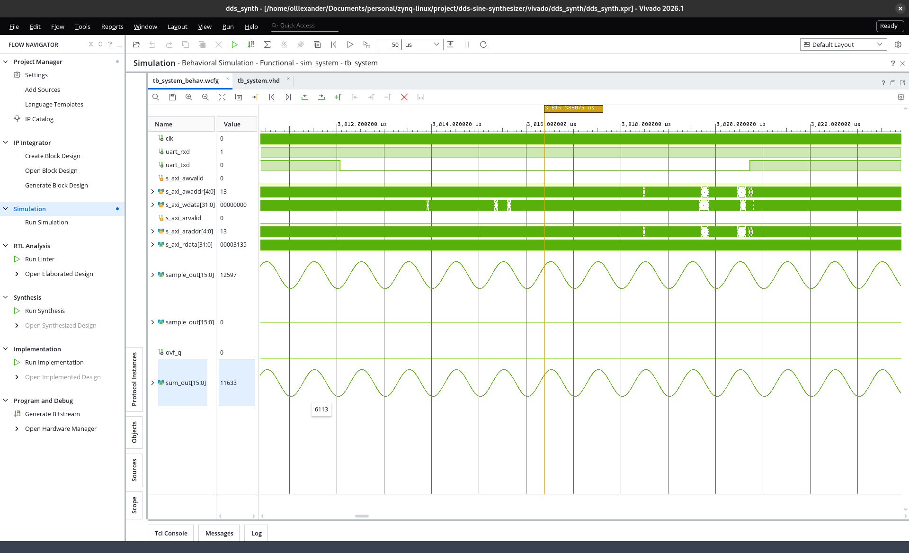
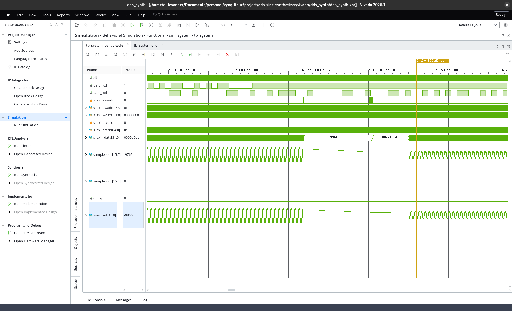
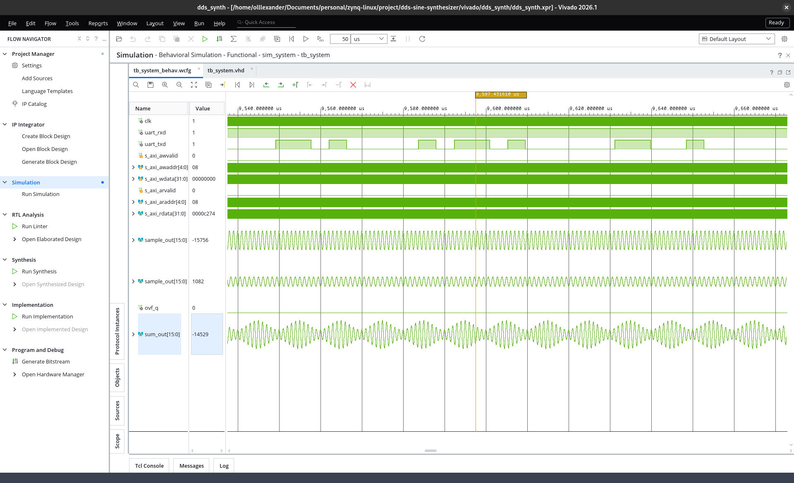

```
==== boot and self-test
uart> 8-channel DDS sine synthesizer
uart> self-test: PASS
uart> type 'help' for usage
==== plain sine 1 MHz, 1 V
term> 1000:1
uart>   ch0  1000.000 kHz  1.000 V  0.000 deg
==== same sine, amplitude 0,5 V (comma separator)
term> 1000:0,5
uart>   ch0  1000.000 kHz  0.500 V  0.000 deg
==== AM: carrier 1 MHz 0.8 V, 100 kHz modulation, m = 0.5
term> 1000:0.8 900:0.2 1100:0.2
uart>   ch0  1000.000 kHz  0.800 V  0.000 deg
uart>   ch1  900.000 kHz  0.200 V  0.000 deg
uart>   ch2  1100.000 kHz  0.200 V  0.000 deg
==== amplitude sum above full scale is rejected
term> 1:1 2:0.7
uart> warning: amplitude sum 1.700 V exceeds 1.650 V full scale, output would clip, line ignored
==== channel amplitude above 1 V is rejected
term> 1:1.2
uart> error: tone 1: amplitude above 1.000 V, line ignored
==== malformed tone is rejected
term> 1:abc
uart> error: tone 1: expected <freq_kHz>:<amp_V>[:<phase_deg>], line ignored
==== all channels off
term> off
uart>   all channels off
SYSTEM TB RESULT: PASS
```

Повний прогін — близько 25 мс модельного часу; майже весь час іде на UART (43 мкс на символ при 230400 бод).

---

## 8. Крок 7. Implementation: ресурси й таймінг

Ресурси одного IP (`dds_channel_0`, звіт Utilization у режимі Hierarchy):

| LUT | FF | DSP | BRAM (36 Кб) |
|---|---|---|---|
| 196 | 193 | 1 | 0,5 |

DSP — множник амплітуди, половина блока BRAM — таблиця синуса 1024 × 16. Інші канали ідентичні (196–197 LUT).

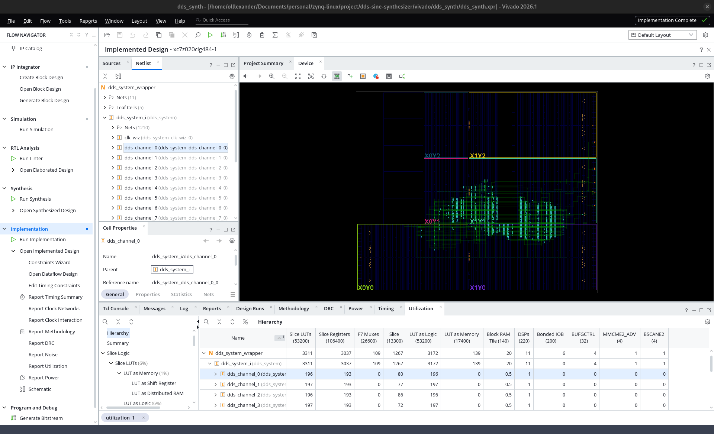

Таймінг на 100 МГц: **WNS = +1,501 нс**, TNS = 0, WHS = +0,033 нс, порушень немає.
Проєкт вкладається в час із запасом 1,5 нс на такт 10 нс; найдовший шлях тепер — розведення сигналу скидання
до регістрів каналів, а не арифметика. Цифри знято до вставки ILA; з ILA WNS = +1,888 нс.

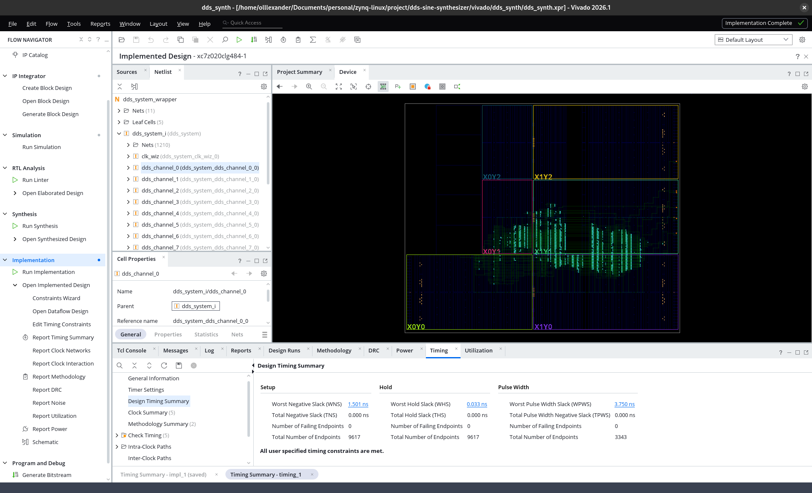

Весь дизайн без ILA: 3311 LUT, 3037 FF, 20 BRAM (16 — пам'ять MicroBlaze, 4 — таблиці 8 каналів), 11 DSP
(8 каналів + 3 у множнику MicroBlaze).

---

## 9. Додатково: запуск на платі

Бітстрім з прошивкою в BRAM (`vivado/build_bitstream.tcl`) прошито через JTAG. Прошивка стартує сама,
керування — з термінала `picocom -b 230400 /dev/ttyUSB0`.

### Командний рядок

```
dds> help
usage: <freq_kHz>:<amp_V>[:<phase_deg>] ...   up to 8 tones, one per channel
       decimal separator '.' or ',', e.g. 1,5 kHz = 1500 Hz
       e.g. 1:0.8 3:0.267 5:0.16
       off    all channels off
       help   this text
limits: amplitude <= 1.000 V per channel, sum <= 1.650 V, frequency < 50000 kHz
dds> 1000:0.8 1050:0.8
  ch0  1000.000 kHz  0.800 V  0.000 deg
  ch1  1050.000 kHz  0.800 V  0.000 deg
dds> 900:0.5 1100:0.5
  ch0  900.000 kHz  0.500 V  0.000 deg
  ch1  1100.000 kHz  0.500 V  0.000 deg
dds> 100:0.8 300:0.267 500:0.16 700:0.114 900:0.089 1100:0.073 1300:0.062 1500:0.053
  ch0  100.000 kHz  0.800 V  0.000 deg
  ch1  300.000 kHz  0.267 V  0.000 deg
  ch2  500.000 kHz  0.160 V  0.000 deg
  ch3  700.000 kHz  0.114 V  0.000 deg
  ch4  900.000 kHz  0.089 V  0.000 deg
  ch5  1100.000 kHz  0.073 V  0.000 deg
  ch6  1300.000 kHz  0.062 V  0.000 deg
  ch7  1500.000 kHz  0.053 V  0.000 deg
dds> 100:1 300:0.111:180 500:0.04 700:0.0204:180
  ch0  100.000 kHz  1.000 V  0.000 deg
  ch1  300.000 kHz  0.111 V  180.000 deg
  ch2  500.000 kHz  0.040 V  0.000 deg
  ch3  700.000 kHz  0.020 V  180.000 deg
dds> 100:0.2 200:0.2 300:0.2 400:0.2 500:0.2 600:0.2 700:0.2 800:0.2
  ch0  100.000 kHz  0.200 V  0.000 deg
  …
  ch7  800.000 kHz  0.200 V  0.000 deg
dds> 1000:0.5 1000:0.5:180
  ch0  1000.000 kHz  0.500 V  0.000 deg
  ch1  1000.000 kHz  0.500 V  180.000 deg
dds> 1000:1 2000:0.7
warning: amplitude sum 1.700 V exceeds 1.650 V full scale, output would clip, line ignored
dds> 1000:0.5 1000:0.5:90
  ch0  1000.000 kHz  0.500 V  0.000 deg
  ch1  1000.000 kHz  0.500 V  90.000 deg
```

### ILA: сигнал прямо з кристала

ILA (4096 відліків на 100 МГц = 41 мкс) знімає суму `summer_sum_out`, відліки каналів 0–2 і прапорці `sync`/`ovf`.
Шини показано в режимі Analog.

| Кадр | Рядок | Що видно |
|---|---|---|
| 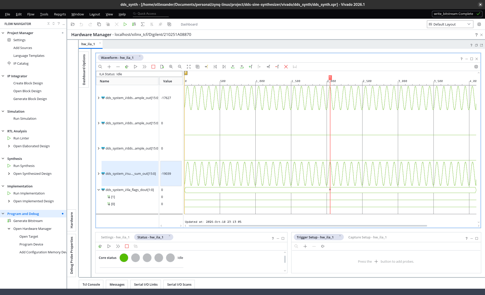 | `1000:1` | синусоїда 1 МГц, ~40 періодів у вікні |
| 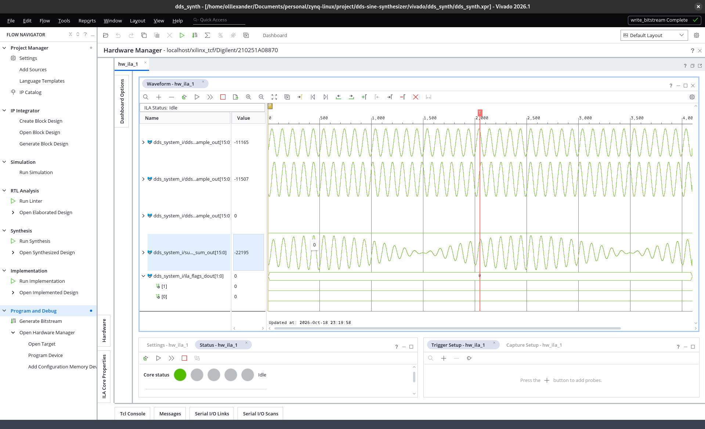 | `1000:0.8 1050:0.8` | биття: обвідна 50 кГц |
| 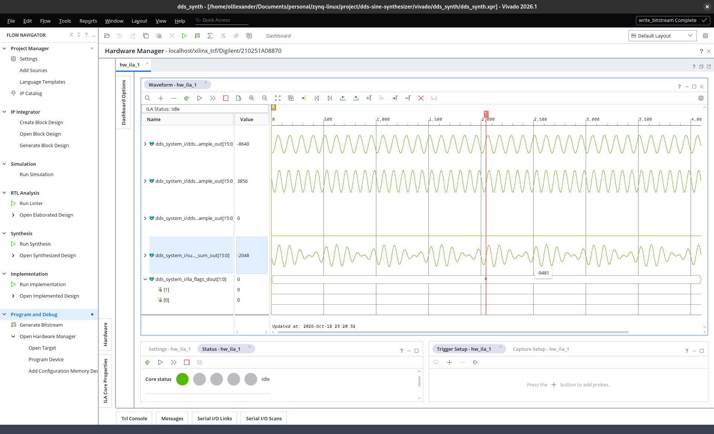 | `900:0.5 1100:0.5` | AM без несучої: обвідна з переходом через нуль |
| 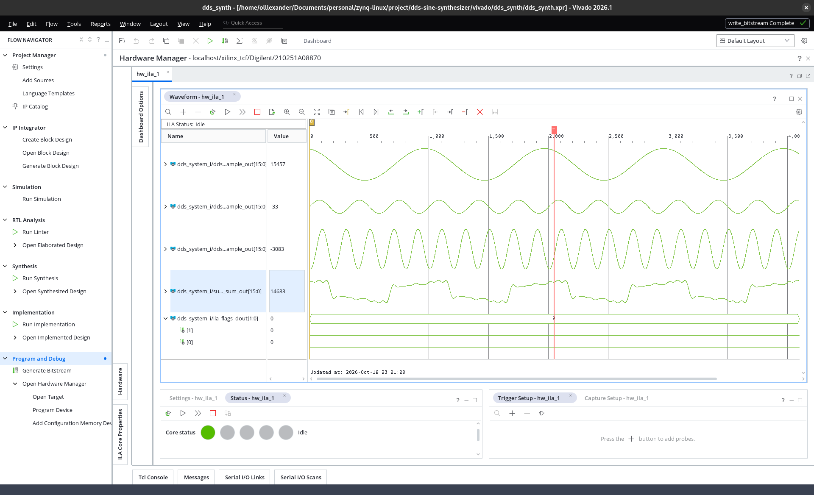 | 8 непарних гармонік 100 кГц, амплітуди 1/k | меандр з викидами Гіббса |
| 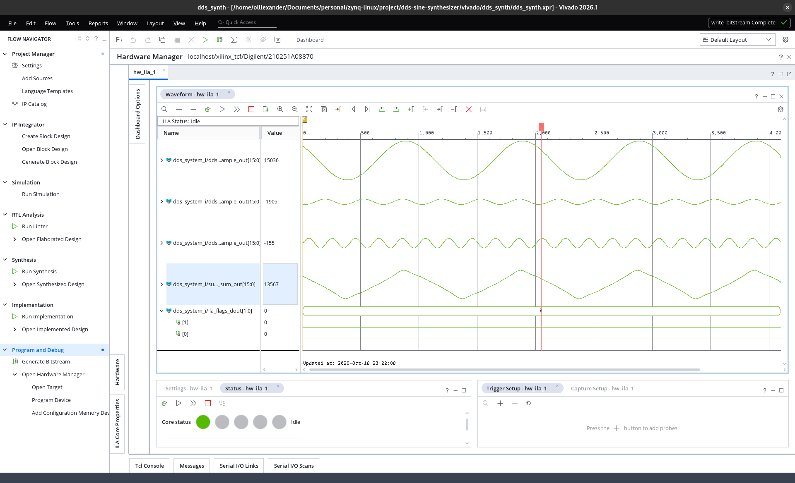 | 4 непарні гармоніки, 1/k², знак через фазу 180° | трикутник |
| 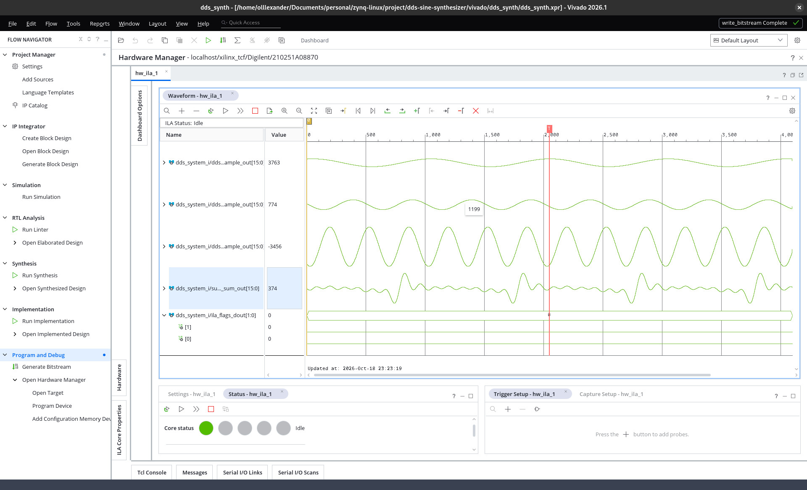 | 8 рівних гармонік 100…800 кГц | вузькі імпульси раз на 10 мкс (ядро Діріхле) |
| 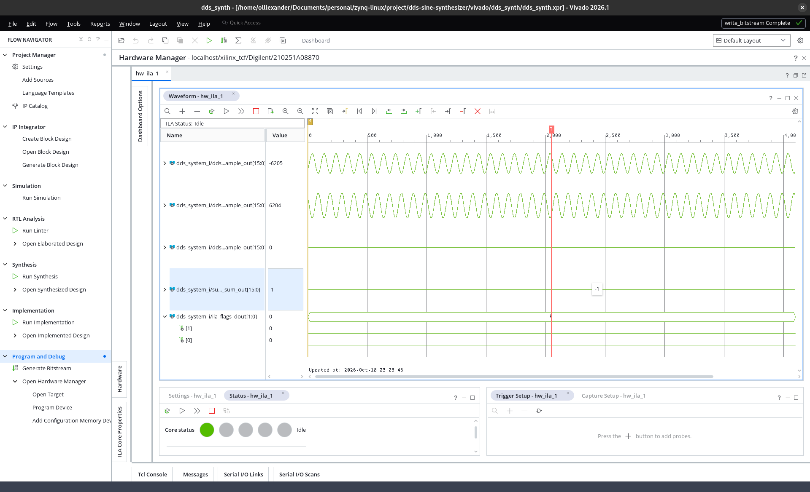 | `1000:0.5 1000:0.5:180` | канали −6205 і +6204, сума −1 — фактично нуль |
| 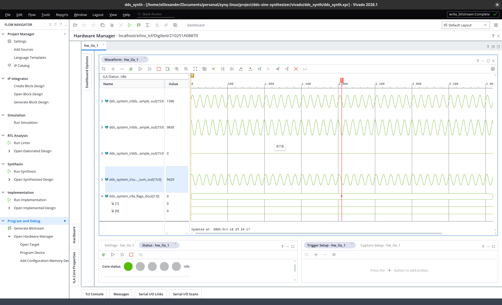 | `1000:0.5 1000:0.5:90` | сума в √2 більша за кожен канал |
|  | `1000:0.8 900:0.2 1100:0.2` | AM: несуча, бічні смуги вчетверо менші, обвідна 100 кГц |

Кадр з протифазою підтверджує одразу три речі: `sync` вирівнює фази каналів з точністю до такту, амплітуди
однакові, суматор точний. Залишкове −1 — та сама асиметрія округлення вниз, що й у сценарії 2:
`floor(−a) + floor(a) = −1` для нецілого `a`.

---

## 10. Обґрунтування рішень

**Чому 8 каналів.** На прикладі меандра 1 кГц з непарних гармонік A/k: восьма непарна гармоніка (15 кГц) вже
впирається у зріз RC-фільтра відновлення (~16 кГц) і в роздільну здатність 8-бітного осцилографа (~15 мВ на
розряд при ±1,65 В). Дев'ята й далі майже не покращують форму (залишкова помилка 17,7 % → 12,5 % при подвоєнні
каналів), але забирають амплітуду в основної, бо сума амплітуд обмежена 1,65 В.

**Чому такі розрядності.** Акумулятор 32 біти дає крок частоти 0,023 Гц і рівно лягає в регістр. Таблиця на 1024
точки займає мінімальний блок BRAM (RAMB18). Відлік 16 біт відповідає ширині порту BRAM і входу DSP48; цифрові
джерела шуму (квантування ~98 дБ, усічення фази ~60 дБ) лежать нижче за шум 1-бітного сигма-дельта виходу з RC.
Зменшення розрядності не звільнило б жодного блоку.

**Чому насичення, а не зсув суми.** Зсув 19-бітної суми на 3 біти гарантує відсутність переповнення, але обмежує
один канал до 1/8 шкали (0,2 В). Насичення разом з перевіркою суми амплітуд у прошивці (≤ 1,65 В) дає повні
1 В на канал, а прапорець `ovf` лишається страховкою.

**Відоме обмеження.** Під час застосування нового рядка вихід ~60 мкс тримає останнє значення, поки прошивка
перераховує й записує регістри всіх каналів (видно на `08b`). Для генератора це прийнятно; усунути можна подвійною
буферизацією регістрів.

---

## 11. Проблеми і як їх розв'язано

1. **MicroBlaze у системній симуляції крутився на адресі 0.** Vivado підмішував у `.mem` локальної пам'яті
   стандартний `mb_bootloop_le.elf` поверх нашої прошивки, і вектор скидання брався з bootloop. Рішення:
   `USED_IN_SIMULATION = 0` для bootloop і прив'язка нашого ELF до `microblaze_0` одночасно для синтезу й симуляції
   (`vivado/associate_elf.tcl`).
2. **Після перезбирання прошивки ELF «відв'язувався».** Vivado перевіряє контрольну суму прив'язаного ELF і при
   невідповідності мовчки підставляє bootloop у бітстрім (`[Project 1-3966] ELF association failed`).
   Рішення: перев'язувати ELF після кожної збірки (той самий скрипт викликає `build_bitstream.tcl`).
3. **Таймінг: WNS лише +0,166 нс.** Критичний шлях — сума восьми входів і насичення за один такт (12 рівнів логіки).
   Рішення: три ступені конвеєра в `summer`; WNS став +1,501 нс.
4. **Критичне попередження про два такти на одному піні.** Порт `clk` у Block Design уже оголошений як 50 МГц,
   а `create_clock` у XDC створював другий такт. Рішення: прибрати `create_clock` з XDC.
5. **Перевірка піку в системному тестбенчі давала хибний FAIL.** Тестбенч читав відлік за своїм тактом 50 МГц, а канал
   видає відліки на 100 МГц, тож точний пік іноді пропускався. Рішення: реагувати на кожну зміну `sample_out`.

---

## 12. Відмінності від заявки

- Частота в CLI задається в кілогерцах (`1,5` = 1500 Гц), а не в герцах.
- Зламана копія — `sim/broken/dds_core_broken.vhd` (змінено лише ядро, обгортка AXI та сама).
- `summer` має три такти конвеєра (у заявці — комбінаційна сума з регістром).
- Шина суми назовні не виводиться: на платі для неї немає 16 вільних пінів, вона йде на `sd_dac` і в ILA.
- Насичення суматора на рівні системи через CLI недосяжне, бо прошивка відхиляє рядок із сумою понад 1,65 В;
  у системному тесті перевіряється, що `ovf` лишається 0.

---

## 13. Висновок

Модуль `dds_channel` реалізовано на VHDL як IP з п'ятьма регістрами AXI4-Lite, перевірено тестбенчем із трьома
сценаріями й порахованими вручну значеннями (PASS) та зламаною копією (FAIL, 23 помилки), упаковано в IP Catalog
і зібрано у систему з MicroBlaze. Системна симуляція з реальною прошивкою підтвердила запис і читання регістрів
та роботу командного рядка (PASS). Канал займає 196 LUT, 193 FF, 1 DSP і пів блока BRAM; проєкт вкладається в
100 МГц із запасом 1,5 нс. На платі синтезатор керується з термінала, а ILA показує ті самі форми, що й симуляція:
синус, биття, AM, меандр і трикутник з гармонік, точне гасіння в протифазі.
